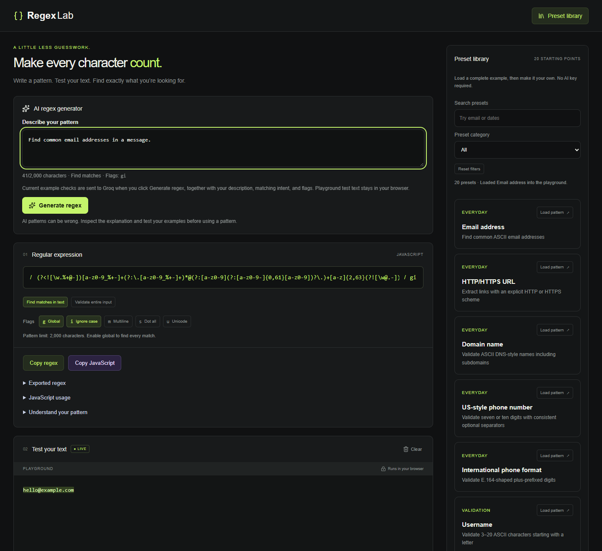
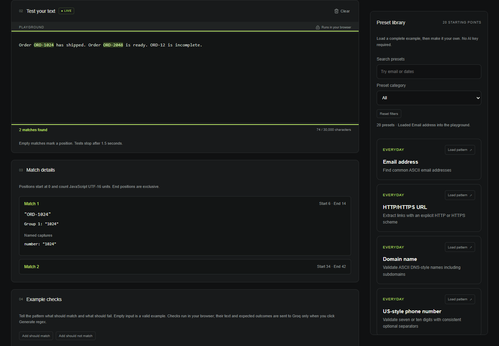
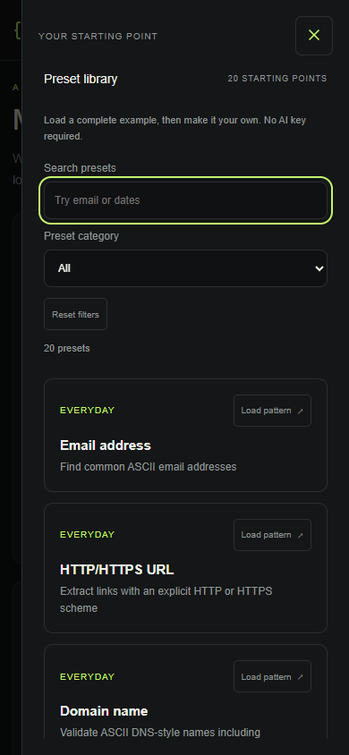

# RegexLab

A small tool for better patterns. Made to match.

Describe what you want to match, generate a JavaScript regular expression, and test it against your own text. Start from a preset or write a pattern yourself—no account required.

[Try the live demo](https://regex-lab-three.vercel.app/)

## Screenshots

### Desktop workbench

Describe a pattern, edit the regular expression, and browse the searchable preset library beside the playground.

### Live testing and capture groups

Test sample order numbers, see matching text highlighted, and inspect the values extracted by a named capture group.

### Presets on mobile

Open the preset drawer to search or filter patterns, then load one into the playground.

## What you can do

- **Generate with AI:** explain your goal in plain language and add examples that should or should not match.
- **Test as you type:** edit the pattern, flags, or test text to see highlighted matches and a live match count.
- **Choose your matching intent:** find matches within text or validate the entire input.
- **Explore 20 presets:** search common patterns for email addresses, URLs, phone formats, dates, numbers, and developer formats.
- **Inspect the result:** view match positions, numbered and named capture groups, and passing or failing example checks.
- **Understand and copy:** expand the explanation and syntax reference, then copy the effective regex or a JavaScript usage snippet directly from the regex panel.

The desktop preset library has its own scrolling area and sticky filters. On tablet and mobile, open **Preset library** to browse in a drawer. The core workflow supports keyboard navigation.

## Getting started

1. Describe your pattern and click **Generate regex**, or open **Preset library** and load a starting point.
2. Review the regular expression, choose your matching intent, and adjust the flags if needed.
3. Enter your own text in **Test your text** to see what matches.
4. Add positive and negative **Example checks** to check the behavior you expect. These examples also guide your next AI generation.
5. Expand **Understand your pattern** for the explanation and limitations. Use **Copy regex** or **Copy JavaScript** when you are ready.

For example, describe “Find order numbers starting with ORD followed by six digits.” Try `ORD123456` as a positive example and `ORD123` as a negative example, then test a larger sample such as `Your order is ORD123456` in find-matches mode.

## Presets

| Category        | Examples                                                                                      |
| --------------- | --------------------------------------------------------------------------------------------- |
| Everyday        | Email address, HTTP/HTTPS URL, domain name, US-style phone number, international phone format |
| Validation      | Username, password format, URL slug, ASCII alphanumeric                                       |
| Dates & numbers | ISO-style date, 24-hour time, integer, decimal number                                         |
| Developer       | IPv4 address, UUID v4, hex color, semantic version                                            |
| Text            | Whitespace runs, ASCII hashtag, file extension                                                |

Loading a preset brings its pattern, settings, sample text, explanation, limitations, and example checks into the playground together. Presets describe supported formats; a date pattern, for example, does not guarantee that a date exists on the calendar.

## Your text and AI

Playground test text stays in your browser. When you click **Generate regex**, your description, explicit example checks, matching intent, and selected flags are sent to the server and Groq. Choose what to include in your description and examples.

AI generation depends on the site's configuration and provider availability. Presets, manual editing, and local testing remain available when AI is unavailable. AI results can be incorrect; review the explanation and test matching and non-matching inputs before using a pattern.

## Playground limits

RegexLab uses JavaScript regular expressions. It supports global, ignore-case, multiline, dot-all, and Unicode flags. Whole-input validation ignores global iteration, and copied output preserves the selected matching intent.

Local tests stop after 1.5 seconds to keep the interface responsive. Patterns accept up to 2,000 characters, playground text up to 30,000 characters, and example checks up to 20 inputs of 1,000 characters each. Results show up to 500 matches and identify when the list is clipped. Copied JavaScript runs in your own environment without the playground's time limit.

## For developers

For local installation, AI configuration, verification commands, and hosting instructions, see the [development guide](docs/development.md).
